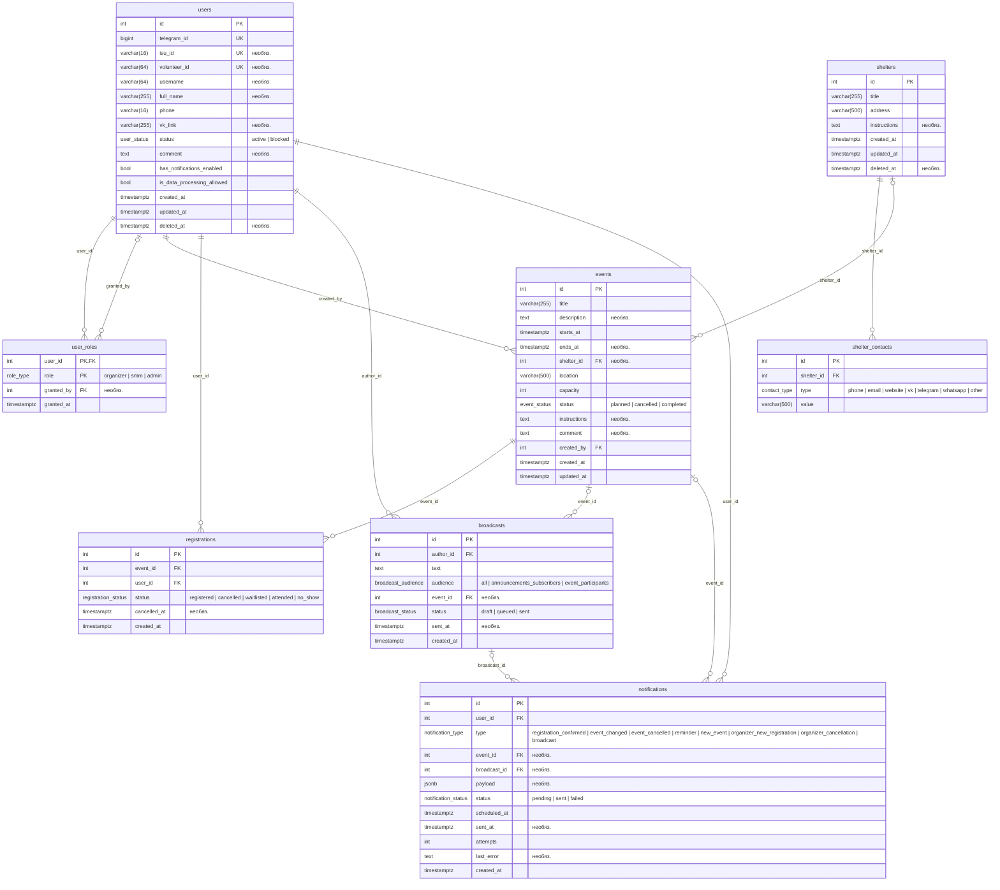

# Схема БД: Paw Volunteer Space

## Ограничения и индексы

- `users`: `status <> 'blocked' OR (comment IS NOT NULL AND btrim(comment) <> '')` (`ck_users_blocked_requires_comment`)
- `users`: `phone ~ '^\+[0-9]{10,15}$'` (`ck_users_phone_format`)
- `shelter_contacts`: `btrim(value) <> ''` (`ck_shelter_contacts_value_not_empty`)
- `shelter_contacts`: уникальна комбинация (shelter_id, type, value)
- `events`: `capacity > 0` (`ck_events_capacity_positive`)
- `events`: `ends_at IS NULL OR ends_at > starts_at` (`ck_events_ends_after_start`)
- индекс `ix_events_status_starts_at` по (status, starts_at)
- `registrations`: уникальна комбинация (event_id, user_id)
- индекс `ix_registrations_user_id` по (user_id)
- индекс `ix_registrations_event_id_status` по (event_id, status)
- `broadcasts`: `(audience = 'event_participants') = (event_id IS NOT NULL)` (`ck_broadcasts_event_matches_audience`)
- индекс `ix_broadcasts_author_id` по (author_id)
- индекс `ix_notifications_broadcast_id` по (broadcast_id)
- индекс `ix_notifications_user_id` по (user_id)
- индекс `ix_notifications_pending_scheduled_at` по (scheduled_at) где `status = 'pending'`

## Правила, которые живут в БД вне моделей

- Роли `admin` и `organizer` может выдать только администратор. Правило реализовано
  триггером `trg_user_roles_check_granter` в миграции. Исключение: самовыдача роли
  `admin`, пока в таблице нет ни одного администратора.
